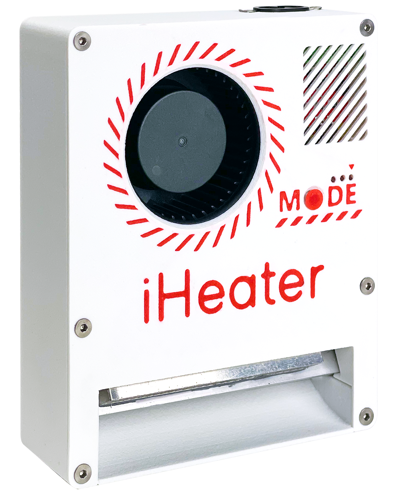

<!-- [](https://github.com/pavluchenkor/iHeater-Standalone-Firmware/releases) -->
<!-- [](https://docs.idryer.org/iHeater/) -->
<!-- [](https://t.me/iDryer) -->
<!-- [](https://discord.gg/jGce5eeHHz) -->


# Samostatný firmware iHeater

iHeater je kompaktní a dostupné řešení pro 3D tiskárny bez aktivní teplotní komory nebo s omezeným připojením na základní desku. Je zvláště užitečné pro modely s proprietárními deskami, kde nejsou volné konektory pro větrák, topidlo nebo termistor. iHeater řeší tento problém jednoduchým a univerzálním způsobem.


Může pracovat nezávisle se svým vlastním firmwarem jako samostatné zařízení nebo pod správou Klipper s připojením k tiskárně přes USB



---

## O firmware

**iHeater** je firmware pro autonomní zařízení pro řízení teploty komory 3D tiskárny.

---

## Účel

Zařízení zajišťuje ohřev a udržování stabilní teploty uvnitř komory 3D tiskárny, což je rozhodující pro tisk ABS, ASA a dalších teplotně závislých plastů s vysokou srážkou a nízkou adhezí vrstev.

---

## Jak nakonfigurovat firmware

### Soubor `config.h`

V tomto souboru se nastavují parametry činnosti zařízení:
Soubor se nachází ve složce Core/Inc/config.h

| Parametr                                    | Účel                                                                                          |
| ------------------------------------------- | --------------------------------------------------------------------------------------------------- |
| `SELECTED_THERMISTOR_TYPE`                  | Výběr typu termistoru (0-5, viz níže)                                                               |
| `MODE_TEMP_0`-`MODE_TEMP_7`                 | Teploty pro každý režim. Můžete nastavit jakoukoli hodnotu, včetně desetinných, např. `MODE_TEMP_4 67.5` |
| `MAX_TEMP`, `MIN_TEMP`                      | Povolený rozsah teplot topidla                                                          |
| `MAX_AIR_TEMP`, `MIN_AIR_TEMP`              | Rozsah teplot vzduchu                                                                         |
| `HEATER_MIN_PWM`                            | Minimální PWM, při kterém systém začne kontrolovat odpověď topidla                             |
| `HEATER_RESPONSE_TIMEOUT_MS`                | Čas čekání na nárůst teploty topidla (výchozí 5 s)                                   |
| `AIR_TARGET_TIMEOUT_MS`                     | Maximální čas dosažení cílové teploty vzduchu (výchozí 10 min)                     |
| `TIMER_CLOCK`, `PWM_FREQUENCY`, `PWM_STEPS` | Nastavení frekvence a kvality PWM                                                                    |

### Termistory

Volí se v `SELECTED_THERMISTOR_TYPE`. Podporovány:

| ID | Typ                          | Poznámka                           |
| -- | ---------------------------- | ------------------------------------- |
| 0  | ATC Semitec 104GT-2          | Standard od E3D                       |
| 1  | ATC Semitec 104NT-4-R025H42G | Analogový 104GT                          |
| 2  | EPCOS 100K B57560G104F       | Populární                             |
| 3  | Generic 3950                 | **Výchozí**, široce používaný |
| 4  | SliceEngineering 450         | Podpora vysokých teplot          |
| 5  | TDK NTCG104LH104JT1          | Zdravotnický, přesný                   |

### Teplotní režimy a LED diody

Režim se nastavuje hodnotou teploty a zobrazuje se v binární formě třemi LED diodami:

Při vstupu do režimu se LED diody blikají, při dosažení režimu - svítí neustále

| Mode   | Temperature | LED3 | LED2 | LED1 |
|--------|-------------|------|------|------|
| MODE_TEMP_0  | 0.0°C       |   |   |   |
| MODE_TEMP_1  | 55.0°C      |   |   |   |
| MODE_TEMP_2  | 60.0°C      |   |   |   |
| MODE_TEMP_3  | 65.0°C      |   |   |   |
| MODE_TEMP_4  | 70.0°C      |   |   |   |
| MODE_TEMP_5  | 75.0°C      |   |   |   |
| MODE_TEMP_6  | 80.0°C      |   |   |   |
| MODE_TEMP_7  | 85.0°C      |   |   |   |

---
### Automatické zapnutí a vypnutí r1.1

Makra
```
#define TRIGGER_ON_TEMP  45.0f
#define TRIGGER_OFF_TEMP 80.0f
#define TRIGGER_MODE MODE_2
```

Jsou odpovědny za teplotu zapnutí a vypnutí topidla a také za režim při zapnutí.

Předpokládejme, že termistor spouště je umístěn v oblasti topné desky.
S aktuálním nastavením se ohřev komory zapne, když teplota desky dosáhne 45 a vypne se, když teplota desky klesne pod 80. Tyto parametry jsou přijatelné pro většinu plastů vyžadujících aktivní teplotní komoru a nezpůsobují logické konflikty během provozu.

Můžete také vybrat režim, který bude spuštěn, když se spouště aktivuje. Například nyní je vybrán TRIGGER_MODE MODE_2 a to znamená, že bude spuštěn režim MODE_TEMP_2 - teplota v komoře 60.0°C

---
### Práce s iHeater-link (sestava r1.1 pulse)

Sestava `iheater_rev1_1_pulse` je určena ke spolupráci s modulem iHeater-link na ESP. Modul přijímá příkazy z tiskárny, portálu nebo mobilní aplikace a překládá nastavení komory do iHeater přes jednu GPIO linku. Firmware iHeater je nezávislý na straně tiskárny a neví o přenosu - přijímá pouze číslo: požadovanou teplotu vzduchu v komoře v °C.

#### Připojení

1. Nahrajte do iHeater sestavu `iheater_rev1_1_pulse` (viz sekce "Jak nahrát").
2. Signální vodič z iHeater-link připojte ke konektoru **TH2** desky iHeater (pin PB1).
3. Společná GND mezi ESP a iHeater je povinná - použijte samostatný vodič uzemnění.
4. Termistor topidla nechejte na svém standardním konektoru **TH0**. Termistor vzduchu - na **TH1**. Pracují jako v jakékoli jiné sestavě.
5. Konektor spouště se v této sestavě nepoužívá (jeho linka je obsazena digitálním vstupem).

!!! warning "Nikdy nepřipojujte a neodpojujte signální vodič při přivedeném napájení."

#### Přijaté příkazy

| Kód z iHeater-link | Smysl |
|---------------------|--------|
| `0`                 | Vypnout ohřev |
| `10`                | Vypnout ohřev (dohodnutý "off-code") |
| `45..90`            | Zapnout ohřev, nastavení vzduchu v °C se rovná kódu |
| ostatní hodnoty  | Ignorovány, je zachováno předchozí stav |

Minimum `45 °C` je nastaveno v `config.h` makrem `PULSE_MIN_TARGET`. Maximum je omezeno `MAX_AIR_TEMP` (výchozí 90 °C).

#### Indikace LED

| Stav | LED1 | LED2 | LED3 |
|-----------|------|------|------|
| Čekání na první balíček po zapnutí | běžící světla LED1 → LED2 → LED3 s krokem 1000 ms | | |
| Spojení OK, ohřev vypnut | svítí nepřetržitě (heartbeat "spojení žije") | zhasnut | krátká záře ~80 ms na každý přijatý balíček |
| Spojení OK, ohřev zapnut | běžící světla LED1 → LED2 → LED3 s krokem 200 ms | | |
| Spojení ztraceno (více než 5 s bez balíčku po prvním připojení) | „Maják“: všechny tři LED současně bliknou na ~100 ms každé 2 s. Topidlo je vypnuto, ventilátor je zapnut. | | |

Standardní chyby (přehřátí, přerušení termistoru, topidlo neodpovídá) fungují stejně jako v analogových sestaven - viz sekce "Co dělat v případě chyby".

#### Chování při ztrátě spojení

Firmware vypne ohřev, když přestanou přicházet příkazy z iHeater-link, a obnoví provoz, jakmile znovu začnou přicházet.

Po zapnutí firmware čeká na první balíček a zobrazuje pomalá běžící světla (krok 1000 ms). Topidlo je vypnuto. Čekání není časově omezeno: dokud spojení nebylo ani jednou navázáno, chybějící balíčky se nepovažují za ztrátu spojení.

Po přijetí prvního balíčku platí pravidlo: pokud balíčky nepřicházejí déle než **5 sekund**, spojení se považuje za ztracené. Během těchto 5 sekund iHeater pracuje podle posledního příkazu.

Při ztrátě spojení:

1. Topidlo se vypne.
2. Ventilátor se zapne a běží až do obnovení spojení.
3. LED zobrazují „maják“: všechny tři LED bliknou na ~100 ms každé 2 s.

Do flash se neukládá žádná chyba, ovladač se nerestartuje a tlačítko MODE není třeba stisknout. Jakmile balíčky znovu přicházejí, iHeater provede přijatý příkaz: při žádané hodnotě `45..90` obnoví ohřev, při `0` nebo `10` zůstane vypnutý.

#### Tlačítko MODE

V pulse-sestavě tlačítko MODE **nepřepíná režimy a nespouští kalibraci**. Jeho jedinou funkcí je vymazání uložené chyby při spuštění zařízení. Všechny příkazy ohřevu přicházejí pouze z iHeater-link.

---

## Jak nahrát

### Stáhnout

[Stáhněte firmware ze stránky vydání](https://github.com/pavluchenkor/iHeater-Standalone-Firmware/releases)


### Použití hotového firmware

Firmware je již nakonfigurován s teplotními režimy od MODE_TEMP_0 do MODE_TEMP_7, popsanými výše, a je určen pro práci s termistorem typu Generic 3950 (typ 3 v seznamu v `config.h`).

### Použití DFU režimu (USB)
=== "r1"

    1. Instalujte jumper BOOT0
    2. Připojte USB, zařízení se zobrazí jako DFU
    3.1 Nahrajte firmware pomocí STM32CubeProgrammer:

    3.1.1 Zadejte cestu k souboru `.bin` firmware (například: `Firmware/iHeater_v1.2.3.bin`)
    3.1.2 Nastavte adresu nahrávání: `0x08000000`

    3.1.3 Klikněte na "Start Programming"

    nebo

    3.2 Nahrajte firmware přes příkazový řádek:
        ```bash
        dfu-util -a 0 -s 0x08000000 -D Firmware/iHeater_vX.Y.Z.bin
    4. Odeberte jumper a restartujte napájení

=== "r1.1"

    1. Podržte tlačítko BOOT
    2. Připojte USB, zařízení se zobrazí jako DFU
    3. Nahrajte firmware pomocí STM32CubeProgrammer:

        3.1.1 Zadejte cestu k souboru `.bin` firmware (například: `Firmware/iHeater_v1.2.3.bin`)

        3.1.2 Nastavte adresu nahrávání: `0x08000000`

        3.1.3 Klikněte na "Start Programming"

        nebo

        3.2 Nahrajte firmware přes příkazový řádek:
            ```bash
            dfu-util -a 0 -s 0x08000000 -D Firmware/iHeater_vX.Y.Z.bin
            ```
    4. Restartujte napájení

---

## Jak používat
=== "r1"

    - **Krátké stisknutí** tlačítka MODE - přepínání režimů (0-7)
    - **Dlouhé podržení (2+ s)** - reset režimu na 0 (OFF)
    - **LED diody** zobrazují aktuální režim podle tabulky výše
    - **Blikání LED diod** - režim je aktivní, ale teplota ještě není dosažena
    - **Trvalé světlo** - cílová teplota je dosažena

=== "r1.1"

    !!! note "Rozdíly revizí"
   
        revize r1.1 má spouštěcí port pro automatické zapnutí a vypnutí ohřevu komory. Když připojíte termistor ke spouštěcímu portu, ohřev se zapne a vypne v souladu s teplotami uvedenými v config.h, standardně to je 45 a 80 pro zapnutí a vypnutí ohřevu.

    - **Krátké stisknutí** tlačítka MODE - přepínání režimů (0-7)
    - **Dlouhé podržení (2+ s)** - reset režimu na 0 (OFF)
    - **LED diody** zobrazují aktuální režim podle tabulky výše
    - **Blikání LED diod** - režim je aktivní, ale teplota ještě není dosažena
    - **Trvalé světlo** - cílová teplota je dosažena

---

## Co dělat v případě chyby

Zařízení se automaticky restartuje a zobrazí kód chyby pomocí LED diod, ventilátor bude při tom zapnut.


| Kód   | Popis                               | LED3 | LED2 | LED1  |
|-------|-------------------------------------------|------|------|-------|
| 0x01  | Vzduch nedosáhl cílové teploty včas        |  | |  |
| 0x02  | Topidlo neodpovídá                     | |  |  |
| 0x03  | Ruční vypnutí (nepoužívá se)                  |  |  |  |
| 0x04  | Termistor vzduchu odpojen                | | |   |
| 0x05  | Termistor topidla odpojen             |  | |   |
| 0x06  | Topidlo - přeteplota                     | |  |   |
| 0x07  | Vzduch - přeteplota                        |  |  |   |
| 0x08  | Ztraceno spojení s iHeater-link (pulse-sestava v0.5.0; od v0.5.1 se neukládá) | 0.25 Hz | 0.25 Hz | 0.25 Hz |
| 0xFF  | Neznámá chyba                              |  | |  |


### Vymazání chyby

Podržte tlačítko MODE při spuštění, dokud se indikace LED nezmění. Chyba bude vymazána z flash a zařízení bude pokračovat v normálním provozu.

## Jemné nastavení

V případě, že existuje potvrzení, že odpory termistoru se liší od skutečné teploty, můžete použít funkci jemného nastavení. K tomu je nutné změřit odpory odpovídajících rezistorů a zapsat je místo výchozích hodnot


```C++ title="Skutečný odpor pull-up rezistorů"
#define PULLUP_TH0 4700.0f
#define PULLUP_TH1 4700.0f
#define PULLUP_TH2 4700.0f
```


---

Tento software je licencován pod licencí Apache 2.0. Komerční použití je povoleno. Podrobnosti najdete v souboru [LICENSE](https://github.com/pavluchenkor/iHeater-Standalone-Firmware/blob/main/LICENSE).
